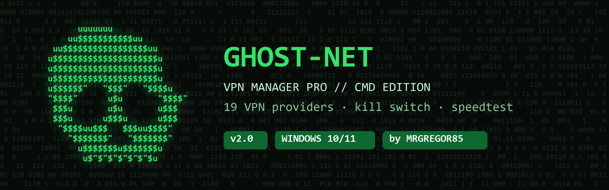
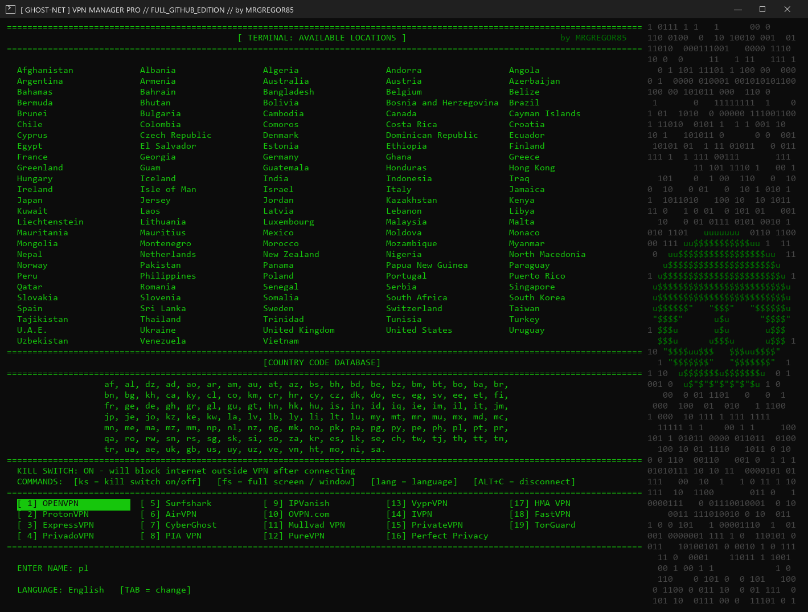
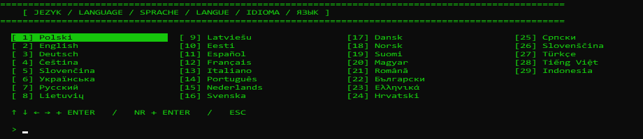
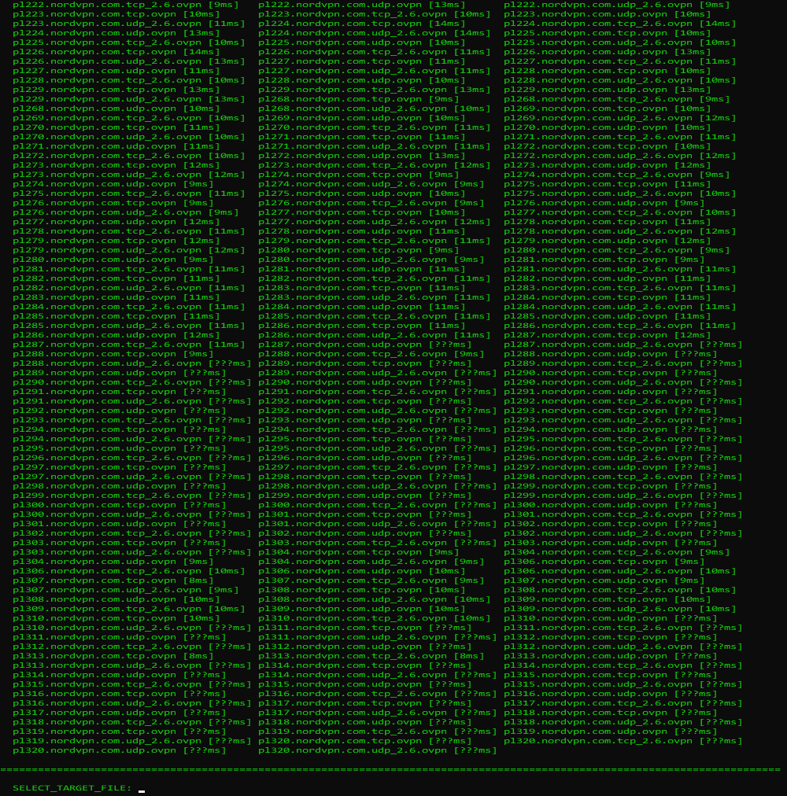
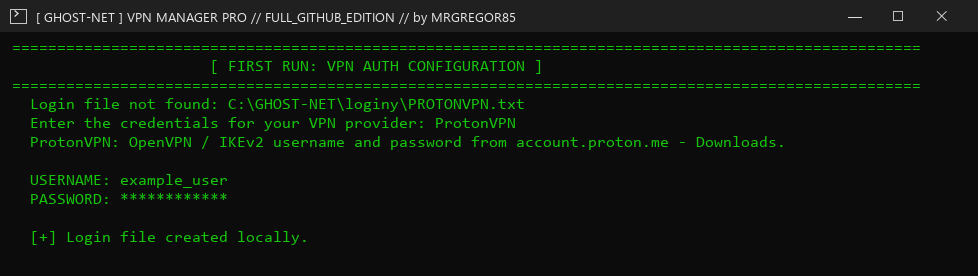
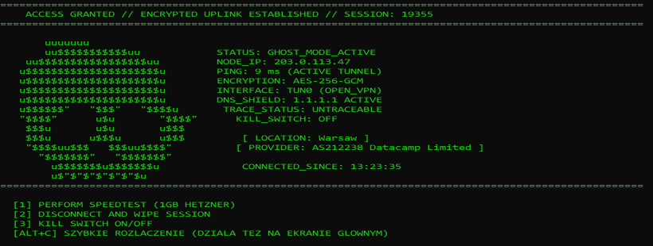

# GHOST-NET VPN MANAGER PRO · Windows 10/11

### VPN desde CMD: eliges un país, escribes un servidor y estás conectado. 19 proveedores VPN, kill switch y speedtest.

<picture></picture> <picture></picture> 

**Windows 10 y 11 · funciona con GhostVPN**

## [🇵🇱 Polski](../README_PL.md) · [🇬🇧 English](../README.md) · [🇩🇪 Deutsch](README_DE.md) · [🇨🇿 Čeština](README_CS.md) · [🇸🇰 Slovenčina](README_SK.md) · [🇺🇦 Українська](README_UK.md) · [🇷🇺 Русский](README_RU.md) · [🇱🇹 Lietuvių](README_LT.md) · [🇱🇻 Latviešu](README_LV.md) · [🇪🇪 Eesti](README_ET.md) · [🇪🇸 Español](README_ES.md) · [🇫🇷 Français](README_FR.md) · [🇮🇹 Italiano](README_IT.md) · [🇵🇹 Português](README_PT.md) · [🇳🇱 Nederlands](README_NL.md) · [🇸🇪 Svenska](README_SV.md) · [🇩🇰 Dansk](README_DA.md) · [🇳🇴 Norsk](README_NO.md) · [🇫🇮 Suomi](README_FI.md) · [🇭🇺 Magyar](README_HU.md) · [🇷🇴 Română](README_RO.md) · [🇧🇬 Български](README_BG.md) · [🇬🇷 Ελληνικά](README_EL.md) · [🇭🇷 Hrvatski](README_HR.md) · [🇷🇸 Српски](README_SR.md) · [🇸🇮 Slovenščina](README_SL.md) · [🇹🇷 Türkçe](README_TR.md) · [🇻🇳 Tiếng Việt](README_VI.md) · [🇮🇩 Indonesia](README_ID.md)

 

📸 **Pantalla principal.** Arriba: los países donde tu proveedor tiene servidores. Debajo: los códigos de país para escribir, por ejemplo `pl` = Polonia. Más abajo: el estado del kill switch y los 19 proveedores VPN; el resaltado es el que usas. Abajo del todo escribes un código de país.

 

---

## 💀 ¿Qué es GHOST-NET?

Un gestor de VPN en una ventana normal de CMD. Te conecta mediante OpenVPN a un servidor de tu propio proveedor VPN, así las webs ven la IP del servidor en lugar de la tuya. Usa los mismos archivos de servidores que [GhostVPN](https://github.com/MRGREGOR85/GhostVPN-BETA). El programa habla 29 idiomas. Cambia el idioma con `TAB` en la pantalla principal.

 

---

## ✨ Funciones

| Función | Qué hace |
|---|---|
| **19 proveedores VPN** | NordVPN, ProtonVPN, Surfshark, Mullvad y más. Cambia con las flechas o con un número. |
| **Ping en directo** | La lista de servidores muestra cuál es el más rápido. |
| **Kill switch** | El Firewall de Windows bloquea internet fuera de la VPN. Si el túnel cae, tu IP no se filtra. Tu red doméstica sigue funcionando. |
| **Protección DNS** | Las consultas DNS no salen del túnel. |
| **Pantalla de conexión** | Nueva IP, ciudad, proveedor, ping y cifrado. |
| **Speedtest** | Prueba de velocidad con un archivo de 1 GB, resultado en Mbit/s. |
| **Errores inteligentes** | Informe en el Bloc de notas, propuesta del siguiente servidor y descarga automática de nuevos servidores NordVPN. |
| **29 idiomas** | El programa habla 29 idiomas. Cambia el idioma con `TAB` en la pantalla principal. |

 

---

## 📋 Qué necesitas

**Windows 10 u 11** · **[GhostVPN](https://github.com/MRGREGOR85/GhostVPN-BETA)** (o [OpenVPN](https://openvpn.net/community-downloads/)) · **una cuenta de un proveedor VPN** · **permisos de administrador** (el script los pide solo)

 

---

## 📖 Guía

 

### 1️⃣ Descargar

Haz clic en **Descargar GHOST-NET**. Mueve **GhostNet.exe** a su propia carpeta, por ejemplo `C:\GHOST-NET`, porque el script guarda los ajustes y los inicios de sesión a su lado.

 

### 2️⃣ Ejecutar

Haz doble clic en **GhostNet.exe** y pulsa **Sí** cuando Windows pida permiso. Si Windows muestra un aviso: **Más información** → **Ejecutar de todas formas**. En el primer inicio, elige tu idioma.

📸 **29 idiomas.** El programa habla 29 idiomas. Cambia el idioma con `TAB` en la pantalla principal.

 

### 3️⃣ Elegir país

Escribe un código de país y pulsa **Enter**, por ejemplo `pl`, `de` o `us`. Cambia de proveedor con las flechas o con un número del `1` al `19`.

 

### 4️⃣ Elegir servidor

Escribe el nombre del servidor de la lista, o solo su comienzo, por ejemplo `pl1273`, y pulsa **Enter**.

📸 **Lista de servidores.** Cada servidor muestra su ping entre corchetes, el tiempo de respuesta: cuantos menos `ms`, más rápido. `udp` suele ser más rápido, `tcp` pasa mejor los bloqueos. Abajo escribes el servidor elegido.

 

### 5️⃣ Introduce tu usuario (solo la primera vez)

El script pide tu usuario y contraseña de OpenVPN y te dice dónde encontrarlos. NordVPN y Surfshark usan *Service credentials* aparte, no el correo y la contraseña de tu cuenta.

📸 **Primer inicio de sesión.** El script muestra para qué proveedor es el usuario y dónde encontrarlo. La contraseña se oculta con asteriscos. El usuario se guarda una vez y no hace falta escribirlo de nuevo.

 

### 6️⃣ Listo

📸 **Conectado.** `NODE_IP` es tu nueva IP que ven las webs. `PING` es la velocidad del túnel, `ENCRYPTION` el cifrado, y `KILL_SWITCH` indica si internet está bloqueado fuera de la VPN. `LOCATION` y `PROVIDER` son la ciudad y la empresa del servidor. Abajo: `1` speedtest, `2` desconectar, `3` kill switch.

 

---

## ⌨️ Comandos

| Escribe | Qué hace |
|---|---|
| `pl`, `de`, `us`… | servidores de ese país |
| `1` … `19` | cambiar de proveedor VPN |
| `TAB` | cambiar el idioma |
| `ks` | activar o desactivar el kill switch |
| `fs` | pantalla completa o ventana |
| `Alt+C` | desconectar la VPN (funciona en todas partes) |
| `1` / `2` / `3` al estar conectado | speedtest / desconectar / kill switch |

 

---

## 🌍 Proveedores

`NordVPN` (en la lista como **OpenVPN**) · `ProtonVPN` · `ExpressVPN` · `PrivadoVPN` · `Surfshark` · `AirVPN` · `CyberGhost` · `PIA VPN` · `IPVanish` · `OVPN.com` · `Mullvad VPN` · `PureVPN` · `VyprVPN` · `IVPN` · `PrivateVPN` · `Perfect Privacy` · `HMA VPN` · `FastVPN` · `TorGuard`

GHOST-NET no vende VPN: usas tu propia cuenta. Añade los archivos de servidores en GhostVPN.

 

---

## 🆘 ¿Algo no funciona?

| Qué veo | Qué hacer |
|---|---|
| **OpenVPN**: no instalado | Instala [GhostVPN](https://github.com/MRGREGOR85/GhostVPN-BETA) u [OpenVPN](https://openvpn.net/community-downloads/). |
| **.ovpn**: sin archivos de servidor | Añade los servidores de este proveedor en GhostVPN o elige otro proveedor. |
| **AUTH_FAILED** | Elige `1` para probar el siguiente servidor. Si ninguno funciona, elige `2` y vuelve a escribir tu usuario. |
| **TUNNEL FAILED** | Lee el informe en el Bloc de notas. Elige otro servidor. |
| Sin internet tras cerrar la ventana | Abre el script y elige **QUITAR BLOQUEO**, o escribe `ks`. |

> 🔒 Los inicios de sesión se quedan solo en tu ordenador, en la carpeta junto al script. No le des esa carpeta a nadie.

 

---

## 📜 Licencia

### Solo para uso privado y doméstico. GHOST-NET pertenece exclusivamente a su autor, MRGREGOR85.

**No está permitido** venderlo, darlo o enviarlo a otras personas, subirlo a otras webs, foros o Discord, usarlo en una empresa, modificarlo ni copiar su código. Cada uno descarga su propia copia desde esta página. Texto completo: [LICENSE](../LICENSE).

 

---

## 👨‍💻 Autor

### [MRGREGOR85](https://github.com/MRGREGOR85)

[**GhostVPN**](https://github.com/MRGREGOR85/GhostVPN-BETA) · [**WG Installing**](https://github.com/MRGREGOR85/WG-INSTALLING-BETA) · [**CMD HELP**](https://github.com/MRGREGOR85/Windows-10-11-CMD-HELP-GUI-BETA)

### Si GHOST-NET te ayuda, deja una ⭐

