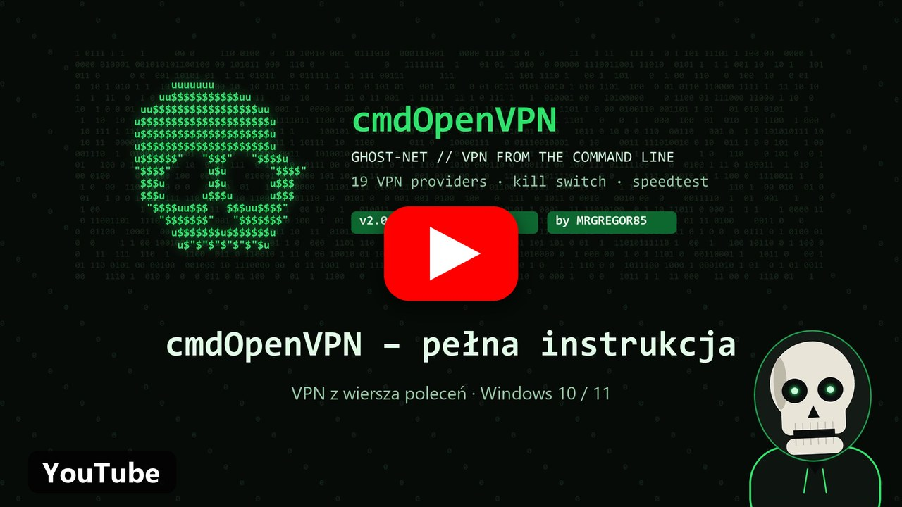

# GHOST-NET VPN MANAGER PRO · Windows 10/11

### VPN från CMD: välj ett land, skriv en server och du är ansluten. 19 VPN-leverantörer, kill switch och hastighetstest.

<picture></picture> <picture></picture> 

**Windows 10 och 11 · fungerar med GhostVPN**

## [🇵🇱 Polski](../README_PL.md) &nbsp; [🇬🇧 English](../README.md) &nbsp; [🇩🇪 Deutsch](README_DE.md) &nbsp; [🇨🇿 Čeština](README_CS.md) &nbsp; [🇸🇰 Slovenčina](README_SK.md) &nbsp; [🇺🇦 Українська](README_UK.md) &nbsp; [🇷🇺 Русский](README_RU.md) &nbsp; [🇱🇹 Lietuvių](README_LT.md) &nbsp; [🇱🇻 Latviešu](README_LV.md) &nbsp; [🇪🇪 Eesti](README_ET.md) &nbsp; [🇪🇸 Español](README_ES.md) &nbsp; [🇫🇷 Français](README_FR.md) &nbsp; [🇮🇹 Italiano](README_IT.md) &nbsp; [🇵🇹 Português](README_PT.md) &nbsp; [🇳🇱 Nederlands](README_NL.md) &nbsp; [🇸🇪 Svenska](README_SV.md) &nbsp; [🇩🇰 Dansk](README_DA.md) &nbsp; [🇳🇴 Norsk](README_NO.md) &nbsp; [🇫🇮 Suomi](README_FI.md) &nbsp; [🇭🇺 Magyar](README_HU.md) &nbsp; [🇷🇴 Română](README_RO.md) &nbsp; [🇧🇬 Български](README_BG.md) &nbsp; [🇬🇷 Ελληνικά](README_EL.md) &nbsp; [🇭🇷 Hrvatski](README_HR.md) &nbsp; [🇷🇸 Српски](README_SR.md) &nbsp; [🇸🇮 Slovenščina](README_SL.md) &nbsp; [🇹🇷 Türkçe](README_TR.md) &nbsp; [🇻🇳 Tiếng Việt](README_VI.md) &nbsp; [🇮🇩 Indonesia](README_ID.md)

 

📸 **Huvudskärm.** Överst: länderna där din leverantör har servrar. Under dem: landskoderna att skriva, till exempel `pl` = Polen. Längre ner: kill switchens status och de 19 VPN-leverantörerna, den markerade är den som används. Längst ner skriver du en landskod.

 

---

## 💀 Vad är GHOST-NET?

En VPN-hanterare i ett vanligt CMD-fönster. Den ansluter dig via OpenVPN till en server hos din egen VPN-leverantör, så webbplatser ser serverns IP i stället för din. Den använder samma serverfiler som [GhostVPN](https://github.com/MRGREGOR85/GhostVPN-BETA). Programmet talar 29 språk. Tryck `TAB` på huvudskärmen för att byta språk.

 

---

## ✨ Funktioner

| Funktion | Vad den gör |
|---|---|
| **19 VPN-leverantörer** | NordVPN, ProtonVPN, Surfshark, Mullvad med flera. Byt med piltangenterna eller ett nummer. |
| **Live-ping** | Serverlistan visar vilken server som är snabbast. |
| **Kill switch** | Windows-brandväggen blockerar internet utanför VPN. Om tunneln faller läcker inte din IP. Hemnätverket fortsätter att fungera. |
| **DNS-skydd** | DNS-förfrågningar lämnar inte tunneln. |
| **Anslutningsskärm** | Ny IP, stad, leverantör, ping och kryptering. |
| **Hastighetstest** | Hastighetstest med en fil på 1 GB, resultat i Mbit/s. |
| **Smarta fel** | Rapport i Anteckningar, nästa server föreslås och nya NordVPN-servrar laddas ner automatiskt. |
| **29 språk** | Programmet talar 29 språk. Tryck `TAB` på huvudskärmen för att byta språk. |

 

---

## 📋 Vad du behöver

**Windows 10 eller 11** · **[GhostVPN](https://github.com/MRGREGOR85/GhostVPN-BETA)** (eller [OpenVPN](https://openvpn.net/community-downloads/)) · **ett konto hos en VPN-leverantör** · **administratörsbehörighet** (skriptet ber om det självt)

 

---

## 📖 Guide

 

### 1️⃣ Ladda ner

Klicka på **Ladda ner GHOST-NET**. Flytta **GhostNet.exe** till en egen mapp, till exempel `C:\GHOST-NET`, eftersom skriptet sparar inställningar och inloggningar bredvid sig.

 

### 2️⃣ Starta

Dubbelklicka på **GhostNet.exe** och klicka på **Ja** när Windows ber om behörighet. Om Windows visar en varning: **Mer information** → **Kör ändå**. Välj ditt språk vid första starten.

📸 **29 språk.** Programmet talar 29 språk. Tryck `TAB` på huvudskärmen för att byta språk.

 

### 3️⃣ Välj land

Skriv en landskod och tryck **Enter**, till exempel `pl`, `de` eller `us`. Byt leverantör med piltangenterna eller ett nummer från `1` till `19`.

 

### 4️⃣ Välj server

Skriv servernamnet från listan, eller bara början, till exempel `pl1273`, och tryck **Enter**.

📸 **Serverlista.** Varje server visar sin ping inom hakparentes, svarstiden: ju färre `ms`, desto snabbare. `udp` är oftast snabbare, `tcp` tar sig lättare förbi blockeringar. Längst ner skriver du servern du vill ha.

 

### 5️⃣ Ange inloggning (bara första gången)

Skriptet frågar efter ditt OpenVPN-användarnamn och lösenord och berättar var du hittar dem. NordVPN och Surfshark använder separata *Service credentials*, inte e-post och lösenord till kontot.

📸 **Första inloggningen.** Skriptet visar vilken leverantör inloggningen gäller och var du hittar den. Lösenordet döljs med asterisker. Inloggningen sparas en gång, nästa gång behöver du inte skriva den igen.

 

### 6️⃣ Klart

📸 **Ansluten.** `NODE_IP` är din nya IP som webbplatser ser. `PING` är tunnelns hastighet, `ENCRYPTION` krypteringen och `KILL_SWITCH` visar om internet utanför VPN är blockerat. `LOCATION` och `PROVIDER` är serverns stad och företag. Längst ner: `1` hastighetstest, `2` koppla från, `3` kill switch.

 

---

## ⌨️ Kommandon

| Skriv | Vad den gör |
|---|---|
| `pl`, `de`, `us`… | servrar i det landet |
| `1` … `19` | byt VPN-leverantör |
| `TAB` | byt språk |
| `ks` | kill switch på eller av |
| `fs` | helskärm eller fönster |
| `Alt+C` | koppla från VPN (fungerar överallt) |
| `1` / `2` / `3` när du är ansluten | hastighetstest / koppla från / kill switch |

 

---

## 🌍 Leverantörer

`NordVPN` (i listan som **OpenVPN**) · `ProtonVPN` · `ExpressVPN` · `PrivadoVPN` · `Surfshark` · `AirVPN` · `CyberGhost` · `PIA VPN` · `IPVanish` · `OVPN.com` · `Mullvad VPN` · `PureVPN` · `VyprVPN` · `IVPN` · `PrivateVPN` · `Perfect Privacy` · `HMA VPN` · `FastVPN` · `TorGuard`

GHOST-NET säljer inte VPN: du använder ditt eget konto. Serverfiler lägger du till i GhostVPN.

 

---

## 🆘 Fungerar något inte?

| Vad jag ser | Vad jag gör |
|---|---|
| **OpenVPN**: inte installerat | Installera [GhostVPN](https://github.com/MRGREGOR85/GhostVPN-BETA) eller [OpenVPN](https://openvpn.net/community-downloads/). |
| **.ovpn**: inga serverfiler | Lägg till leverantörens servrar i GhostVPN eller välj en annan leverantör. |
| **AUTH_FAILED** | Välj `1` för att prova nästa server. Om ingen fungerar, välj `2` och skriv inloggningen igen. |
| **TUNNEL FAILED** | Läs rapporten i Anteckningar. Välj en annan server. |
| Inget internet efter att fönstret stängts | Starta skriptet och välj **TA BORT BLOCKERING**, eller skriv `ks`. |

> 🔒 Inloggningarna stannar bara på din dator, i mappen bredvid skriptet. Ge inte den mappen till någon.

 

---

## 📜 Licens

### Endast för privat bruk i hemmet. GHOST-NET tillhör enbart sin upphovsman, MRGREGOR85.

**Det är inte tillåtet** att sälja det, ge eller skicka det till andra, ladda upp det på andra webbplatser, forum eller Discord, använda det i ett företag, ändra det eller kopiera dess kod. Alla laddar ner sin egen kopia från den här sidan. Fullständig text: [LICENSE](../LICENSE).

 

---

## 🎬 YouTube

**▶ [Komplett videoguide på YouTube](https://youtu.be/Fb_61rHk95Y)** 🇵🇱

 

---

## 👨‍💻 Upphovsman

### [MRGREGOR85](https://github.com/MRGREGOR85)

[**GhostVPN**](https://github.com/MRGREGOR85/GhostVPN-BETA) · [**WG Installing**](https://github.com/MRGREGOR85/WG-INSTALLING-BETA) · [**CMD HELP**](https://github.com/MRGREGOR85/Windows-10-11-CMD-HELP-GUI-BETA)

### Om GHOST-NET hjälper dig, lämna en ⭐

